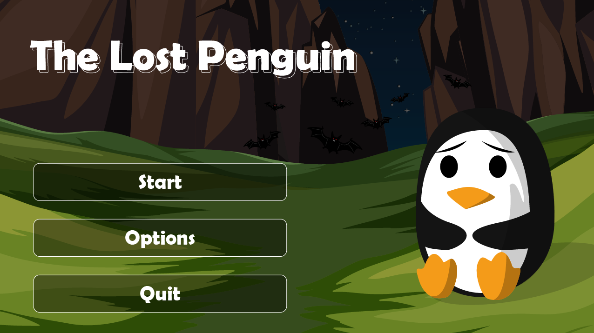
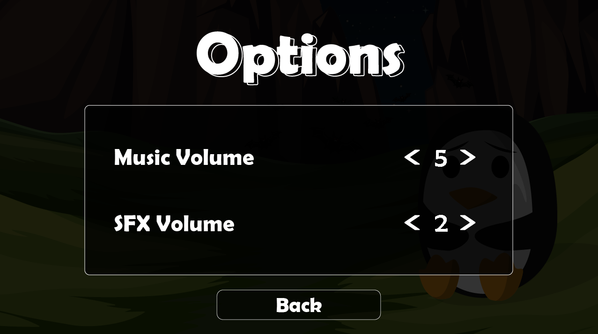
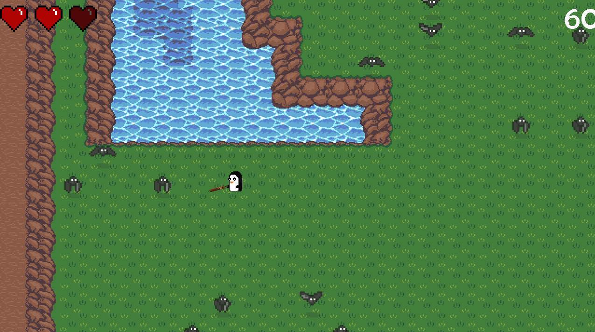
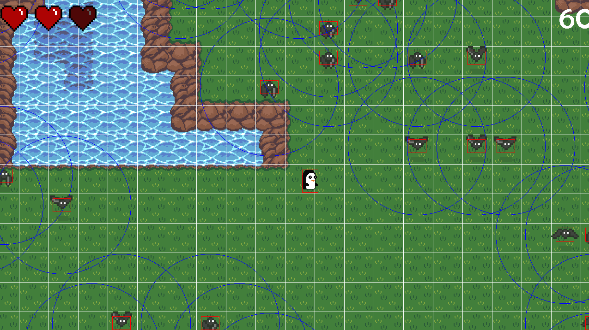
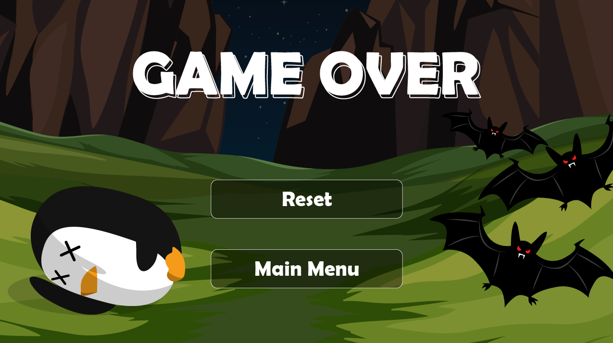

# The Lost Penguin

A prototype 2D game built with **Pygame**, where you control a lost penguin trying to find its way back home while fighting and defeating enemies along the way.


## Features

* **Movement and combat:** 2D movement and attacks with the equipped weapon[cite: 1].
* **Health system:** visual health display using hearts in the top-left corner (supporting half-heart increments)[cite: 1].
* **Score system:** score counter in the top-right corner[cite: 1].
* **Enemies and detection:** enemies (such as bats) with detection zones, animations, and collision handling[cite: 1].
* **Map and entity collisions:** collision detection against terrain/obstacles and enemies[cite: 1].
* **Text-based map configuration:** map layout defined via text codes per tile type (`C17`, `C11`, `G01`, `S03`, etc.) mapped to tile graphics.
* **Audio:** background music and sound effects (SFX).
* **Debug overlay (`F1`):** toggleable display for enemy detection zones, collision boxes, and the map grid.


## Repository Structure

```text
TheLostPenguin/
├── resources/                          # Game assets, audio, and map/data files
├── screenshots/                        # Screenshots with the app
├── main.py                             # Entry point that starts the application
├── game.py, game_state.py, config.py   # Main game loop, game states, and configuration settings.
├── enemy.py, bat.py                    # enemy logic and behavior
├── map.py, tile_images.py              # text-code map loading and tile image mapping.
├── unit.py, unit_move.py, draw_arc.py  # unit movement, entities, and drawing/debug helpers.
├── music.py                            # background music and sound effect management
├── player.py, penguin.py, weapon.py    # Player behavior, animations, and attack mechanics.   
├── requirements.txt                    # requirements 
└── README.md                           # Root overview and quick start guide
```


## Requirements and Installation

The project runs directly from Python source code (`main.py`) and does not include a prebuilt executable.

Tested with Python 3.7.9 and 3.9.0

1. **Clone or download the repository** to your preferred folder and open a terminal in the project root.
2. **Create and activate a virtual environment** (recommended):

```bash
python -m venv myenv
```

- On Windows:
```bash
myenv\Scripts\activate
```
- On macOS / Linux:
```bash
source myenv/bin/activate
```

3. **Install dependencies:**

```bash
pip install -r requirements.txt
```

4. Running the Game

With your virtual environment activated and from the project root directory, run:   
```bash
python main.py
```


## Key Bindings

| Key | Action |
| :--- | :--- |
| `W`, `A`, `S`, `D` or `Arrow Keys` | Move player |
| `SPACE` | Player attack |
| `F1` | Toggle enemy detection zones, collision boxes, and map grid |
| `F2` | Increase player health by half a heart |
| `F3` | Spawn one enemy at a time |
| `F4` | Reset game |
| `ESC` | Return to main menu |


## Screenshots





